<p align="center">
  
</p>

<h1 align="center">Multica for Android</h1>

<p align="center">
  The full Multica workspace — inbox, boards, projects, chat, agents — as a native Android app,<br/>
  built to unfold properly on a Galaxy Z Fold 8.
</p>

<p align="center">
  
  
  
  
  
  
</p>

<p align="center">
  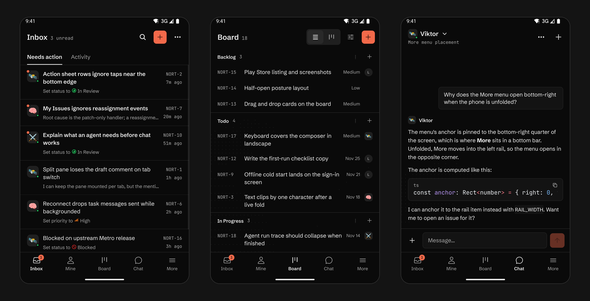
</p>

---

## Why this exists

Multica runs your work as a workspace of issues, projects, agents and conversations — and most of it
happens on a phone, in the gaps between other things. The web app assumes a mouse, a wide window and a
second monitor. The Fold gives you a phone in your hand and a small tablet when it opens, and that is
exactly the shape this app was designed against.

It is not a web view in a shell. It is the same product, rebuilt on Expo Router and React Native, with
the navigation, the board and the layout responding to the fold rather than to a breakpoint someone
guessed at.

---

## What you get

### Inbox that separates what needs you from what happened

Two readings of the same stream: **Needs action** and **Activity**. Unread count lives on the tab and
beside the title, so the number you see is the one you actually care about — not a total.

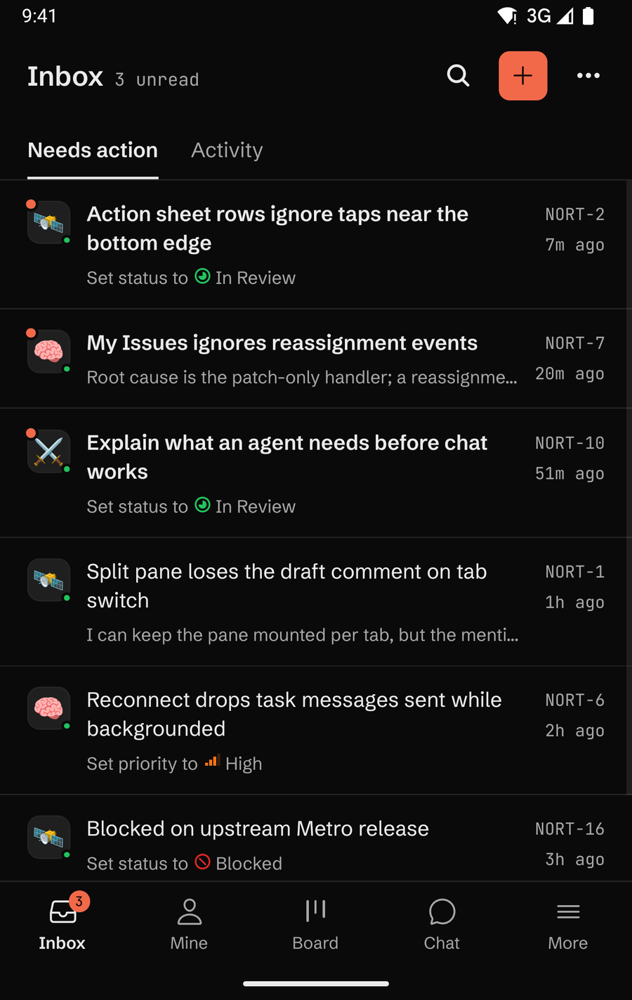

Every row tells you what changed and why it surfaced — *"Set status to Ready for review"*, *"Task
failed"*, *"+3 notes"* — with the actor's avatar (agents keep their own icon on a square tile, people are circles), the issue
key and a relative timestamp. One tap opens
the issue in place; the row also carries the actions you would otherwise open the issue to take.

<br clear="left" />

### Boards that behave like boards

Columns come from the workspace's own workflow, in its own order, with its own colours. Cards carry the
real signal: title, key, priority, labels, assignee. Move a card and the mutation is optimistic — the
column counts update before the request lands, and roll back with an explanation if the server refuses.

<p align="center">
  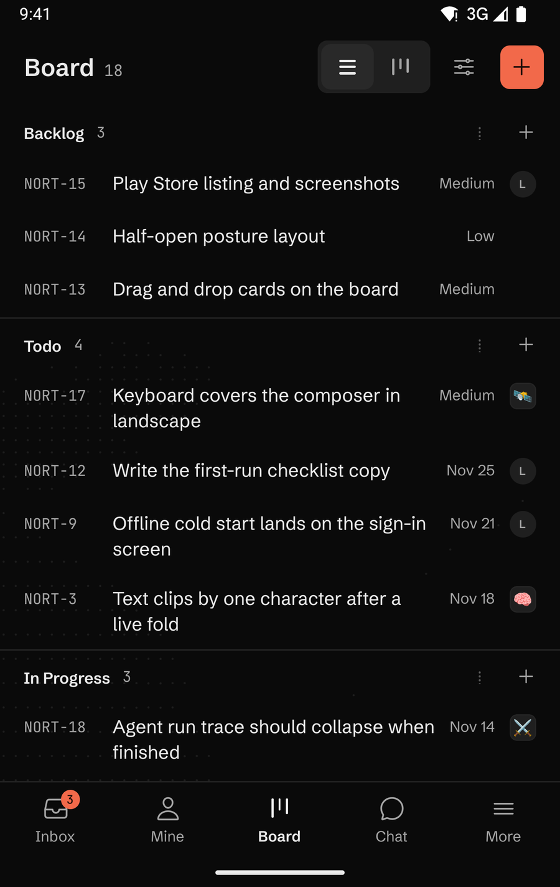
  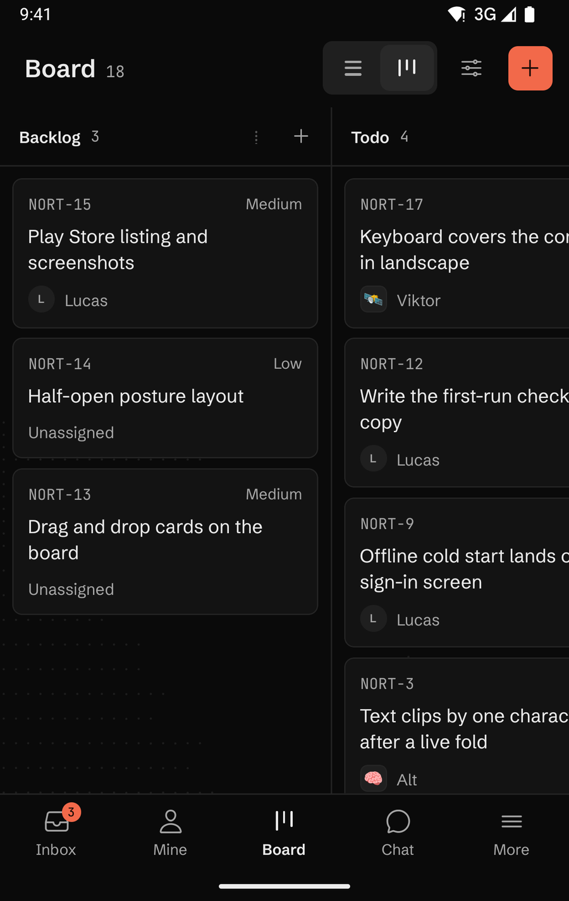
  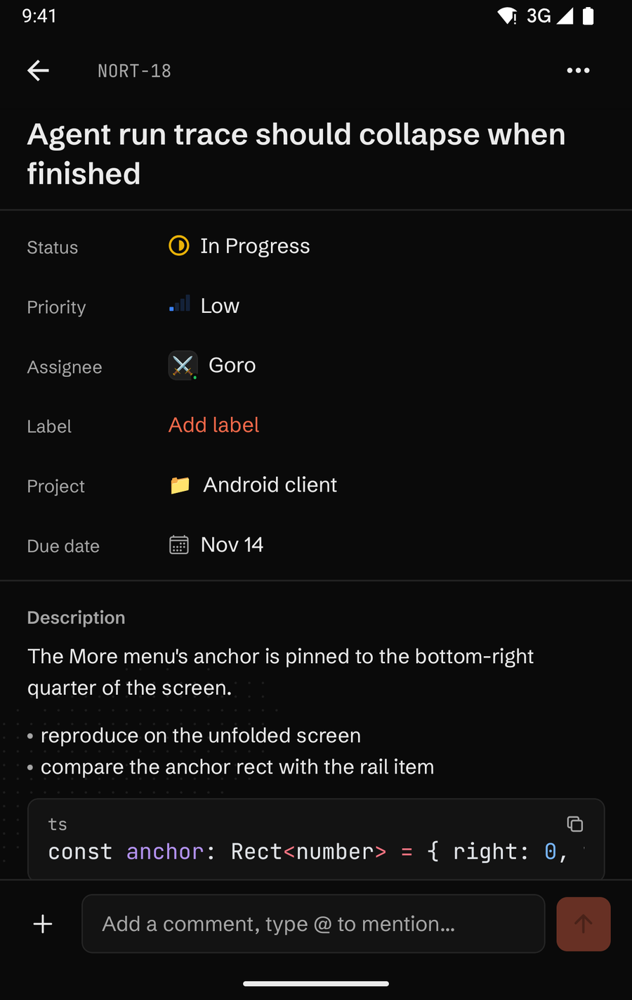
</p>

<p align="center"><sub>One picker in the header switches between a dense list and the kanban, and remembers the choice.</sub></p>

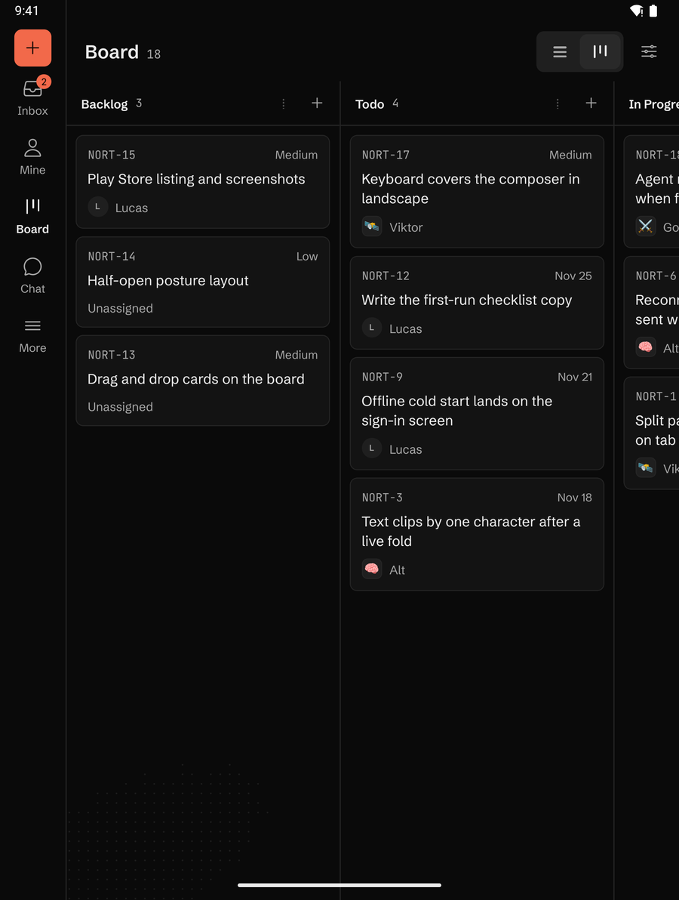

<p align="center"><sub>Unfolded: the tab bar becomes a rail with New issue at the top, and the columns fit beside it.</sub></p>

The interesting part is what happens when the server says no. Workflows can restrict where an issue may
move, and the naive app snaps the card back and says nothing. This one names the blocking workflow and
the statuses it does allow:

> **Move not allowed** — *"Shipped is not a column in the Dreaming workflow. Allowed: Backlog, Doing, In
> review."* (the message is built from the workflow the server names, in the reader's language)

### Projects with two readings of one record

A project is a thing with properties *and* a queue of work. Both live in the same screen behind a quiet
segmented control — no nested tab bar, no second screen to lose your place in.

<p align="center">
  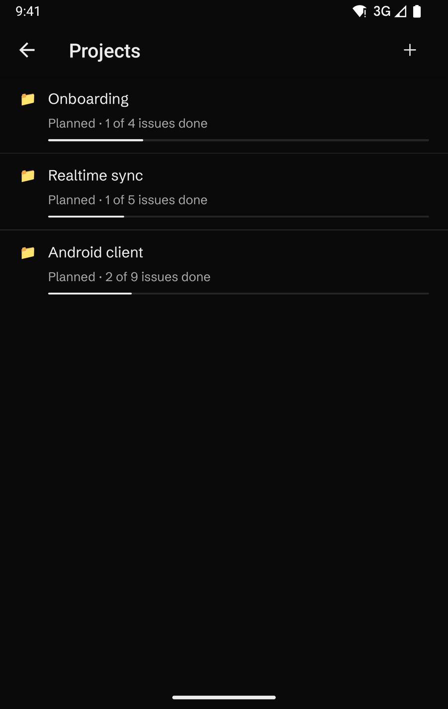
  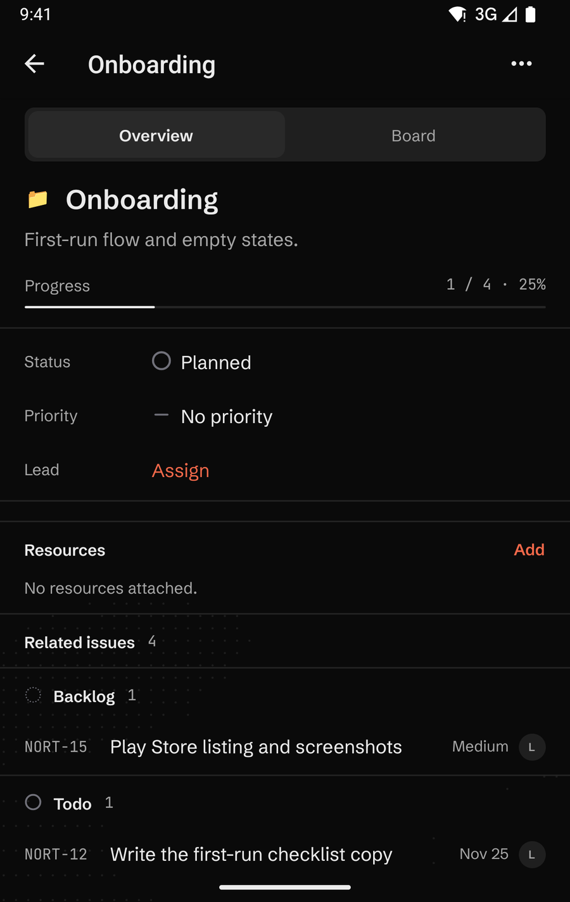
  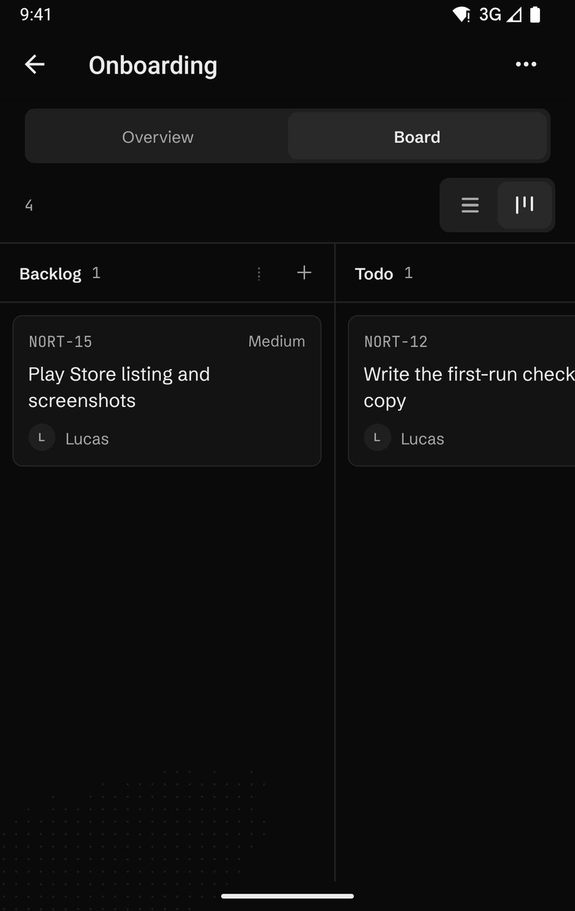
</p>

The project board is deliberately not a second board implementation. It is the same component, the same
ordering and the same move mutation, fed a different issue set — so a card moved on a project board
writes exactly the anchors a card moved on the workspace board would.

### Chat with the agents, at reading width

<p align="center">
  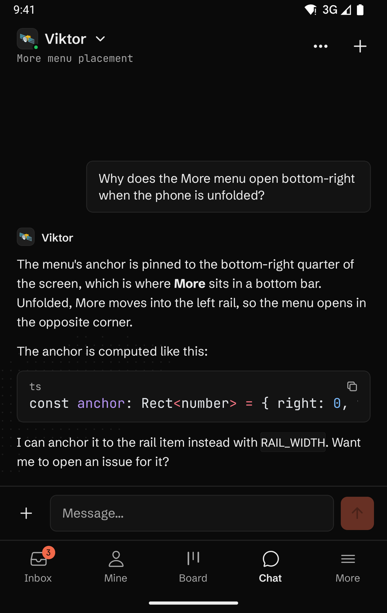
</p>

Full conversation rendering with code, quotes, run summaries and the action row that follows an agent
reply. The composer sits above the keyboard instead of under it — edge-to-edge on Android 15 means the
window no longer resizes for you, so the screen tracks keyboard height itself and turns from centred to
top-anchored the moment the keyboard appears.

### Everything else

<p align="center">
  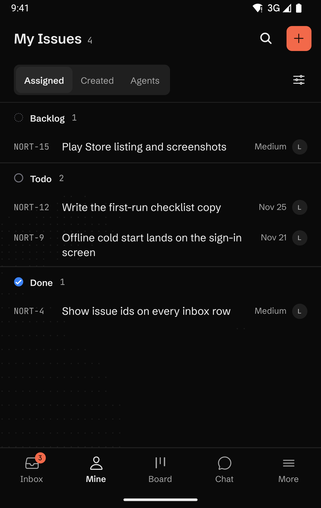
  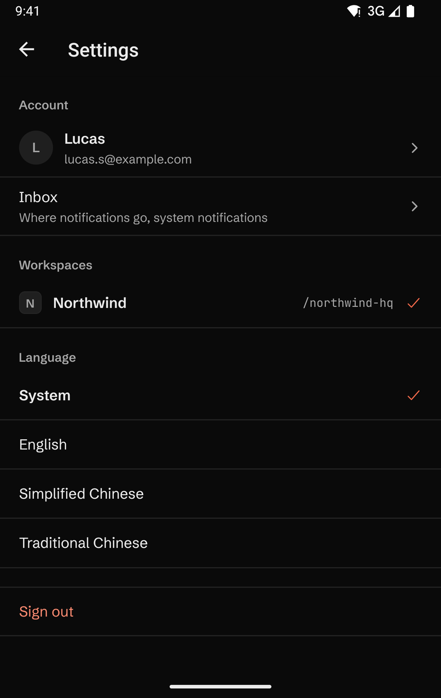
  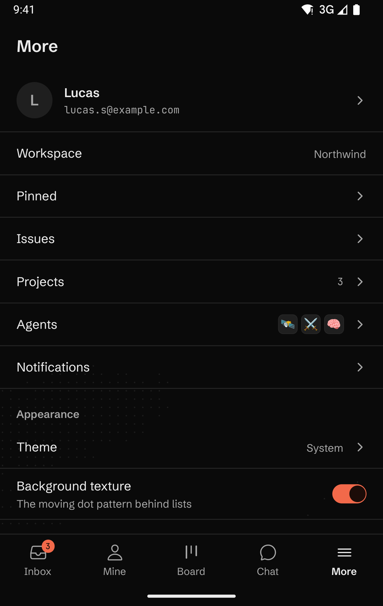
  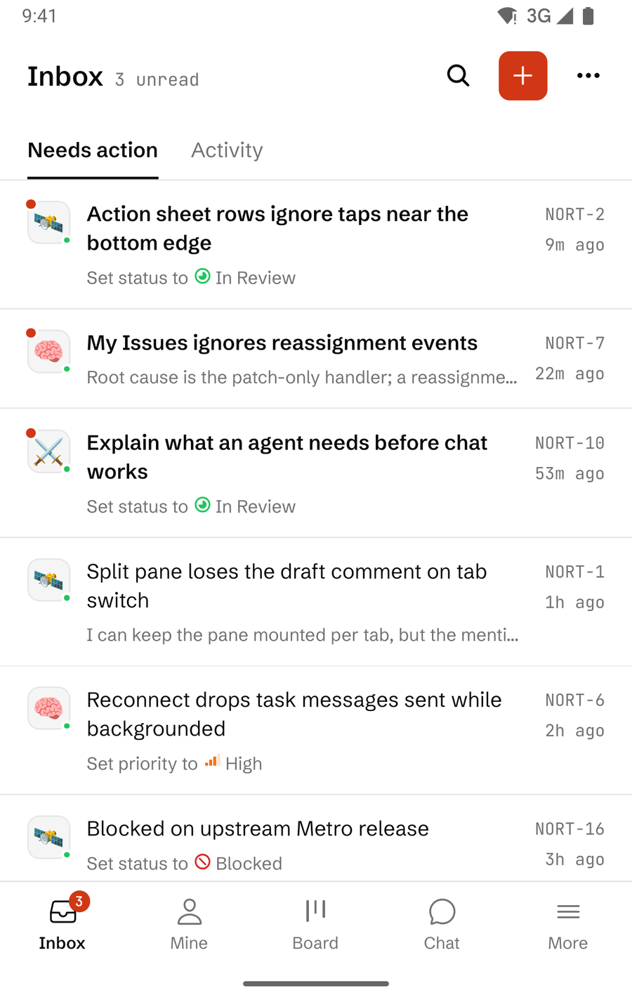
</p>

Fifty-odd screens' worth of parity with the web client: issues and their timeline, search, pins, agent
runs, members, workflows, labels, notifications, workspace switching — plus a light theme, three
locales (English, 简体中文, 繁體中文) and per-workspace scoping throughout.

### Designed dark, with a light theme too

Neutral greys, one vermilion accent, Schibsted Grotesk with JetBrains Mono for ids and counts, and a
very quiet animated texture of tiny glyphs in the empty part of each screen (it can be turned off in
More). The rules are in [`apps/mobile/DESIGN.md`](apps/mobile/DESIGN.md).

<p align="center">
  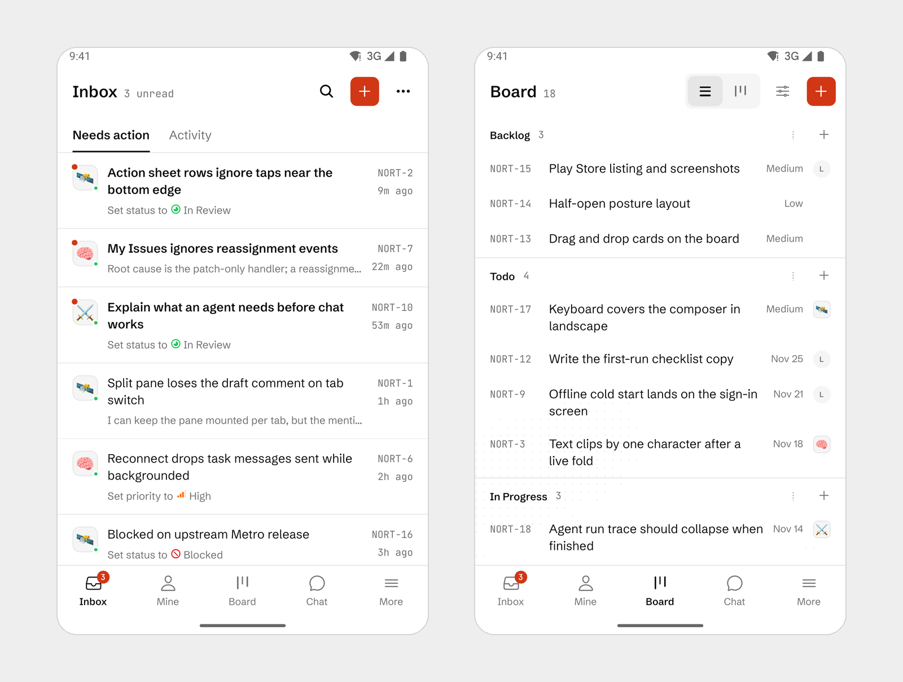
</p>

---

## Built for the fold

<p align="center">
  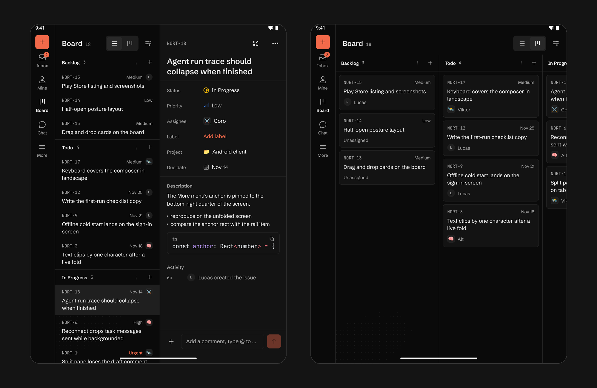
</p>

The Fold 8 is three devices in one: a 467 × 737 dp cover screen, a 734 × 972 dp inner screen, and a
949 × 855 dp Ultra panel. Three decisions follow from that.

**One navigation tree, two layouts.** The tab bar is hand-built. React Navigation's material bar mislays
its destinations at 467 dp, and swapping `tabBarPosition` between bottom bar and rail rebuilt the
navigator tree — which reset the selected tab on every fold. Here the same component only changes flex
direction: five labelled destinations in a bottom bar at compact width, a leading rail with a New issue
button when unfolded.

**List and detail side by side.** Unfolded, tapping an issue in the Board's list view, My Issues or the
Inbox opens it in a pane beside the list instead of replacing the screen. Folding shows the list again;
unfolding brings the same issue back with its scroll position.

**A fold is a relayout, not a remount.** A fold changes both size *and* density, and Android was
recreating the activity because `density` was missing from `configChanges`. Board state, scroll position
and the active tab now survive the hinge, because the activity is never rebuilt.

**Board geometry from the window size class.** One column plus a sliver on the cover screen, two beside
the rail unfolded, three in landscape and DeX. Column width, gutter and edge padding all step from the
same metrics function.

---

## Under the hood

| | |
|---|---|
| **Framework** | Expo SDK 57, React Native 0.86, new architecture, Hermes |
| **Navigation** | `expo-router` with file-based routes, typed deep links (`multica://<workspace>/<route>`) |
| **Data** | TanStack Query over the Multica REST API, shared query keys, cache-first with WS invalidation |
| **Styling** | NativeWind + React Native Reusables primitives; tokens mirrored in `global.css` and `lib/theme.ts` |
| **Board** | One read (`issueListOptions`) projected by `lib/board.ts`; one shared move hook for both boards |
| **Native** | Config plugins for the foldable manifest and NDK pinning — the generated `android/` directory is never edited by hand |
| **Tests** | Vitest, 44 files / 318 tests, plus `tsc --noEmit` and `expo lint` kept at zero |

A few notes that cost real time and are written down in the app so they are not re-learned:

- **NDK 29 is required.** NDK 27's `libc++_shared.so` is missing `__cxa_init_primary_exception`, which
  `libfbjni` calls at startup — the app dies with `SoLoaderDSONotFoundError` before the first frame.
  `expo-build-properties` did not pass the version through, so a plugin patches `app/build.gradle`.
- **Android clips children to their parent's bounds.** There is no `overflow: visible`. Every floating
  element — badges, dropdowns, sheets — is anchored to a box tall enough to legally contain it.
- **Fonts are native families.** Loaded at runtime by name, a custom font gets a synthesised bold on
  Android; the `expo-font` config plugin registers one file per weight so `fontWeight` picks a real cut.
- **Insets lie under `wm size`.** The bottom inset can report zero or negative while the gesture pill is
  still drawn; the bar height is computed as `56 + max(inset, 12)` and never padded with a negative.

---

## Run it

Grab the signed APK from [Releases](../../releases/latest) if you just want to install it, or build it
yourself:

```bash
# prerequisites: Node 20+, pnpm 10+, JDK 21, Android SDK 36, NDK 29.0.14206865
pnpm install

# Android debug build (needs Metro on :8081 or your own port)
cd apps/mobile
pnpm android

# release APK for a device
cd apps/mobile/android
./gradlew assembleRelease -PreactNativeArchitectures=arm64-v8a,x86_64
```

### Signing

Release builds are signed with a real upload key, not the debug key. The certificate lives outside the
repo and reaches Gradle through the environment — `apps/mobile/plugins/with-release-signing.js` rewrites
`app/build.gradle` during `expo prebuild`, so the wiring survives a clean native regeneration:

```bash
export MULTICA_UPLOAD_STORE_FILE=/path/to/upload-keystore.jks
export MULTICA_UPLOAD_STORE_PASSWORD=…        # from your password manager
export MULTICA_UPLOAD_KEY_ALIAS=multica-upload
export MULTICA_UPLOAD_KEY_PASSWORD=…
./gradlew assembleRelease -PreactNativeArchitectures=arm64-v8a,x86_64
```

With those unset the release buildType falls back to the debug key, so the build still works on a
machine that does not hold the key. Verify what you built:

```bash
apksigner verify --print-certs app/build/outputs/apk/release/app-release.apk
```

Because the certificate is not the debug one, an APK from an earlier debug-signed run has to be
uninstalled before this one installs over it. Subsequent releases update in place.

Point the app at a server with `EXPO_PUBLIC_API_URL` (see `apps/mobile/.env.example`), then sign in with
the email code — or, in development, set `EXPO_PUBLIC_DEV_AUTH_TOKEN` to a personal access token from
`~/.multica/config.json` and deep-link straight into a workspace:

```bash
adb shell am start -a android.intent.action.VIEW -d "multica://applied-leverage/board"
```

### Checks that must stay green

```bash
pnpm --filter @multica/mobile typecheck   # tsc --noEmit
cd apps/mobile && ./node_modules/.bin/expo lint
cd apps/mobile && ./node_modules/.bin/vitest run     # 44 files / 318 tests
```

---

## What has been verified, and what has not

Verified on an emulator configured to the Fold 8's three geometries, against a real workspace: sign-in,
inbox triage, board moves (including a workflow-blocked move and its message), project overview and
project board, chat, settings, dark mode, and navigation state surviving a fold.

Not yet verified, and worth saying plainly:

- **No physical Fold 8 has been tested.** The emulator has no hinge sensor, so half-open postures and
  hinge occlusion are unexercised — every "fold" so far is a `wm size` / `wm density` change.
- **Drag-and-drop is a long-press move sheet**, not a finger drag across columns. It is reachable with
  TalkBack and a trackpad, which a drag gesture would not be, but it is not the interaction you expect
  from a board.
- **Signed with a local upload key, not Play App Signing.** The APK verifies and installs, and updates
  in place, but nobody has run it through the Play Console — which is also why the application id is
  still the `.dev` variant.
- **Issue lists cap at 100 rows** without a "showing 100 of N" notice yet.

---

## Layout of this repo

```
apps/mobile/                 the Android app (Expo, expo-router, NativeWind)
  app/(app)/[workspace]/     workspace routes: inbox, board, projects, chat, issues, settings
  components/nav/            the hand-built tab bar / rail
  components/board/          shared board canvas, cards, move hook
  plugins/                   config plugins: foldable manifest, NDK pin, release signing
  ANDROID.md                 build requirements, quirks, known non-fatal warnings
apps/web, apps/desktop       the rest of the Multica monorepo this app shares contracts with
packages/                    shared core, views and UI primitives
server/                      the API this app talks to
```

Upstream product documentation is preserved in [`README.multica.md`](README.multica.md).

---

<p align="center">
  
</p>
<p align="center"><sub>Multica — the agent workspace. Android client built for the Galaxy Z Fold 8.</sub></p>
